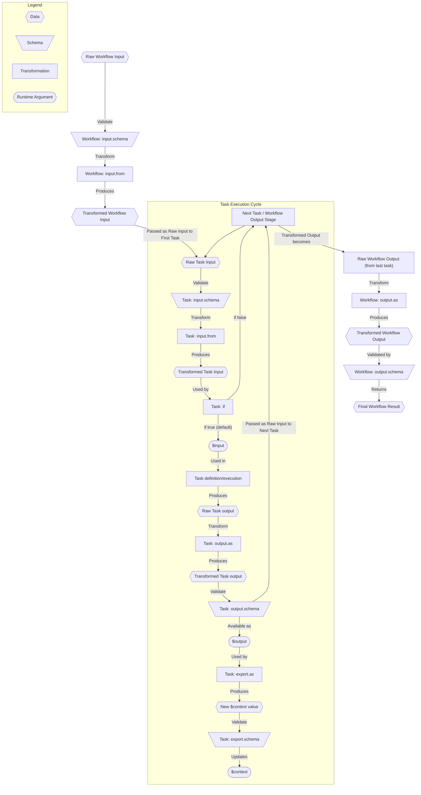

<!-- Examples are validated -->

# Data Flow Management

## Purpose

Effective data flow management is crucial for building robust and maintainable workflows. The Open Workflow DSL
provides specific constructs (`input`, `output`, `export`) at both the workflow and individual task levels to control
how data is validated, transformed, and passed between steps and into the workflow's shared context.

This allows you to:

* Ensure tasks receive only the data they need in the correct format
* Validate data structures at key points to prevent errors
* Shape the final output of tasks and the entire workflow
* Maintain a shared state (`$context`) across tasks in a controlled manner

## Key Concepts and Keywords

Data flows through a sequence of validation and transformation steps:

1. **Workflow Input Processing**:
    * `workflow.input.schema`: Validates the initial `raw input` provided when the workflow starts
    * `workflow.input.from`: Transforms the `raw input` of the workflow.
      The result (workflow's `transformed input`) becomes the initial `raw input` of the *first* task
2. **Task Input Processing** (for each task):
    * `task.input.schema`: Validates the task's `raw input`
      (which is either the `transformed output` of the previous task or the workflow's `transformed input` for the first task)
    * `task.input.from`: Transforms the task's `raw input`.
      The result (task's `transformed input`) is available as `$input` within the task's execution scope
      and is used for evaluating expressions within the task definition
3. **Task Execution**: The task performs its action (e.g., calls an API, runs a script, sets data).
   The result of this action is the task's `raw output`
4. **Task Output Processing** (for each task):
    * `task.output.as`: Transforms the `raw output` of the task.
      The result (task's `transformed output`) is available as `$output` in the task’s export expression and
      becomes the `raw input` for the *next* task (or the workflow's `raw output` if it's the last task)
    * `task.output.schema`: Validates the task's `transformed output`
5. **Task Context Export** (for each task):
    * `task.export.as`: Transforms the task's `transformed output` to update the shared
      context (`$context`) of the workflow
    * `task.export.schema`: Validates the data produced by `export.as` *before* it updates the current
      `$context`
6. **Workflow Output Processing**:
    * `workflow.output.as`: Transforms the workflow's `raw output` (the `transformed output` of the *last* task executed).
      This defines the workflow's `transformed output`, which becomes the final result returned by the workflow execution
    * `workflow.output.schema`: Validates the final `transformed output` of the workflow

## Workflow Level Data Handling

These properties are defined at the top level of the workflow document.

### `input` (Object, Optional) {#workflow-input}

Controls processing of the initial data the workflow receives.

* **`from`** (String | Object | Array | ..., Optional): A [Runtime Expression](dsl-runtime-expressions.md) or literal
  value defining how to transform the raw workflow input. The result is passed as raw input to the first task. Defaults to identity (`${. }`)
* **`schema`** (Schema Definition, Optional): A [JSON Schema](https://json-schema.org/) used to validate the *raw*
  workflow input *before* `input.from` is applied. If validation fails, the workflow faults immediately

The workflow validates a nested customer object and flattens the fields used by its first task.

<code-block lang="yaml" src="workflows/dsl-data-flow/input-object-optional-workflow-input.yaml"/>

### `output` (Object, Optional) {#workflow-output}

Controls processing of the final data returned by the workflow.

* **`as`** (String | Object | Array | ..., Optional): A [Runtime Expression](dsl-runtime-expressions.md) or literal
  value defining how to transform the *transformed output* of the *last* task. Defaults to identity (`${. }`)
* **`schema`** (Schema Definition, Optional): A [JSON Schema](https://json-schema.org/) used to validate the *final
  transformed workflow output* (after `output.as` is applied). If validation fails, the workflow faults

The workflow returns a confirmation ID and leaves the internal status out of the result.

<code-block lang="yaml" src="workflows/dsl-data-flow/output-object-optional-workflow-output.yaml"/>

## Task Level Data Handling

These properties can be defined within individual task definitions.

### `input` (Object, Optional) {#task-input}

Controls processing of data entering a specific task.

* **`from`** (String | Object | Array | ..., Optional): Transforms the task's *raw input*. The result is available as
  `$input` within the task's scope. Defaults to identity (`${ . }`)
* **`schema`** (Schema Definition, Optional): Validates the task's *raw input* *before* `input.from` is applied

The schema checks the wrapper object. The transformation then passes only `data` to the task.

<code-block lang="yaml" src="workflows/dsl-data-flow/input-object-optional-task-input.yaml"/>

### `output` (Object, Optional) {#task-output}

Controls processing of data produced by a specific task.

* **`as`** (String | Object | Array | ..., Optional): Transforms the task's *raw output* (the direct result of its
  action, e.g., HTTP response body, script return value). The result becomes the raw input for the next task and is
  available as `$output` for `export.as`. Defaults to identity (`${. }`)
* **`schema`** (Schema Definition, Optional): Validates the *transformed output* (after `output.as` is applied)

The HTTP task selects the customer ID and validates the resulting object before passing it to the next step.

<code-block lang="yaml" src="workflows/dsl-data-flow/output-object-optional-task-output.yaml"/>

### `export` (Object, Optional)

Controls how the task's results update the shared workflow context (`$context`).

* **`as`** (String | Object | Array | ..., Optional): A [Runtime Expression](dsl-runtime-expressions.md) evaluated
  against the task's *transformed output* (`$output`). The result of this expression **updates** the current value of
  `$context`. Use `$context + { newField: ... }` (jq syntax) to merge with existing context
* **`schema`** (Schema Definition, Optional): Validates the data structure produced by `export.as` *before* it updates
  `$context`

The final step can read the exported customer ID after an intervening task replaces the immediate input.

<code-block lang="yaml" src="workflows/dsl-data-flow/export-object-optional.yaml"/>

## Visualization

The following diagram illustrates the flow of data through validation and transformation stages for both workflow and
tasks:



## Potential Errors

Several types of errors can occur during data flow processing:

1. **Schema Validation Errors (`ValidationError`)**:
    * **When**: Occurs if data fails validation against any schema (`input.schema`, `output.schema`, or `export.schema`)
      at either workflow or task level
    * **Type**: `https://open-workflow-specification.org/spec/1.0.0/errors/validation`
    * **Status**: `400` (Bad Request)
    * **Effect**: The workflow faults immediately unless handled by a `Try` task

2. **Expression Evaluation Errors (`ExpressionError`)**:
    * **When**: Occurs if a runtime expression within `input.from`, `output.as`, or `export.as` fails to evaluate.
      Common causes include:
      - Syntax errors in the expression
      - References to missing data
      - Type mismatches during evaluation
    * **Type**: `https://open-workflow-specification.org/spec/1.0.0/errors/expression`
    * **Status**: `400` (Bad Request)
    * **Effect**: The workflow faults immediately unless handled by a `Try` task

These errors are critical and will cause the workflow execution to halt in a `faulted` state unless properly handled
using error handling mechanisms like `Try` tasks.

## Run the Examples

Complete the [SQLite setup](lemline-tutorial-setup.md) and leave the worker running. Save each workflow in the setup directory under the file name used below.

Use this command from the root of the source checkout to [start the tutorial shop](lemline-tutorial-setup.md#use-the-tutorial-shop).

```bash
docker compose -f examples/tutorial-services/compose.yaml up -d --wait
```

Run these registration and start commands from the setup directory.

```bash
bin/lemline definition post -f input-object-optional-workflow-input.yaml
bin/lemline instance start examples input-object-optional-workflow-input --input '{"customer":{"id":"C-100"},"quantity":2}'
bin/lemline definition post -f output-object-optional-workflow-output.yaml
bin/lemline instance start examples output-object-optional-workflow-output
bin/lemline definition post -f input-object-optional-task-input.yaml
bin/lemline instance start examples input-object-optional-task-input --input '{"data":{"value":7}}'
bin/lemline definition post -f output-object-optional-task-output.yaml
bin/lemline instance start examples output-object-optional-task-output --input '{"customerId":"C-100"}'
bin/lemline definition post -f export-object-optional.yaml
bin/lemline instance start examples export-object-optional --input '{"customerId":"C-200"}'
```

Check the individual results in the worker terminal.

| Example | Expected result |
|---|---|
| `input-object-optional-workflow-input` | `{"customerId":"C-100","units":2}` |
| `output-object-optional-workflow-output` | `{"confirmationId":"ABC-123"}` |
| `input-object-optional-task-input` | `{"doubled":14}` |
| `output-object-optional-task-output` | `{"identifiedCustomer":"C-100"}` |
| `export-object-optional` | `{"action":"processed","customerId":"C-200"}` |

When the instances finish, use the command below in the source checkout to stop the shop.

```bash
docker compose -f examples/tutorial-services/compose.yaml down
```
